# RocketMaxxing

RocketMaxxing is a desktop app for designing and simulating rockets. It runs offline and needs no AI subscription.
Under the hood it is the same engine as the OpenRocket MCP server (OpenRocket 24.12 plus this project's tools), and it
reads and writes ordinary OpenRocket `.ork` files, so a design can go back and forth between the two programs.

Version 0.1.0 covers OpenRocket's three main tabs, and adds the engine's engineering tools, the team's targets with
live margins, flight data after a launch, and an optional assistant. Parts can be dragged, lined up, copied and
pulled apart in an exploded view, and right-click, search, a Guide and a tour make it easy to find things. See
[the plan](APP_PLAN.md) for what comes next.

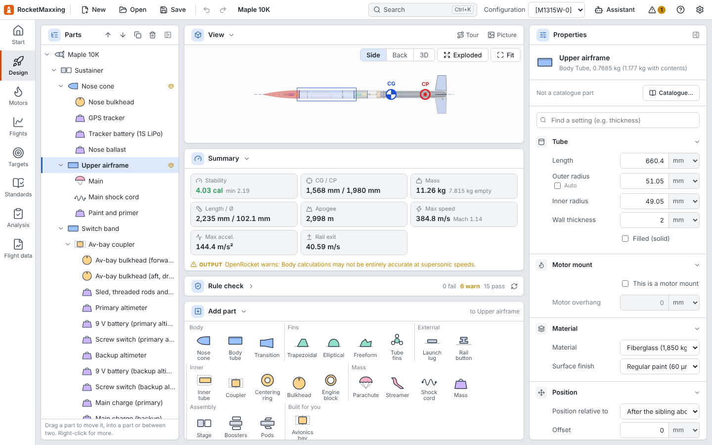

## Getting help in the app

- **Help** at the foot of the left rail: getting started, what each page is for, which analysis, the team
  standards, shortcuts and tips, and the Design page tour. **?** opens the shortcuts and tips from anywhere.
- **Guide** (the ? at the top right, or Guide on the Start page): a first session step by step, with a button to
  each place; what each page is for; which analysis answers which question, with a design-review order; what the
  team standards hold and which analyses use each section; shortcuts.
- **Design page tour**: offered the first time the Design page opens, and from the Tour button on the View panel,
  the Guide or the search ("tour"). Twelve steps, each lighting up one part of the page (parts list, view and its
  modes, pictures, properties, summary, rule check, Add part, configuration, top bar) with what it is for and how to
  use it. Arrow keys or Back / Next move through it; Escape ends it.
- **Analysis › Start here** (the page opens on it): the analyses grouped by the question they answer (is it ready
  and legal, is it stable, will recovery work, will it hold together, which motor, launch day, reports), each with
  why you would run it, and a design review in order.
- **Standards**: a short explanation with links to each section, an ⓘ per section (what it holds, which analyses
  read it) and per value (what it means, with an example). The defaults' sources and assumptions, and the long
  per-material tables (shear modulus, strength…), fold away until opened.
- **ⓘ on every analysis and input**, and **search** (⌘K / Ctrl+K) for anything by what it is for: an analysis
  ("FEA", "chute size"), a page, an action (a view mode, the flight video, importing a motor, a new simulation), a
  part to add or one in the design, a setting of the selected part ("wall thickness"), a team standard ("rail
  length", "pin rating") or a target. Choosing one goes there: the setting's box, the standard's row lit up, the
  dialog open.
- Everything folds: each panel (click its title, or right-click it for the others), the sections of Properties,
  the analysis groups, the target groups (flight, off the rail, stability and structure, recovery and landing, mass)
  and the sections of Settings.

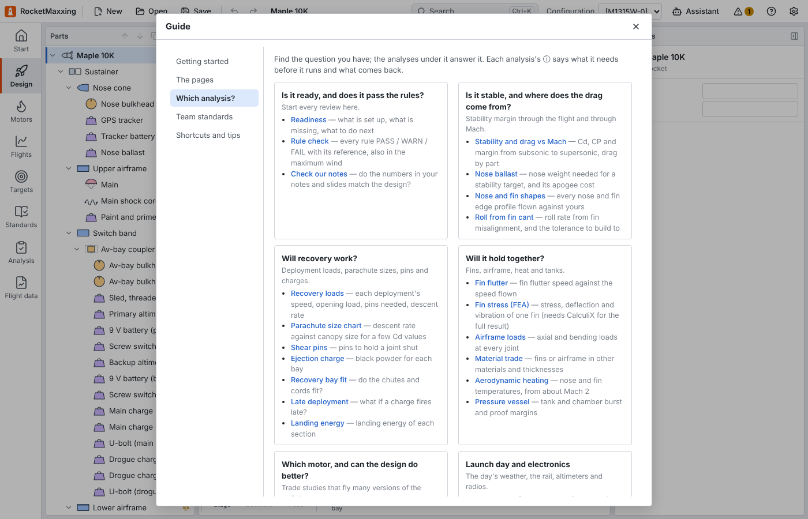

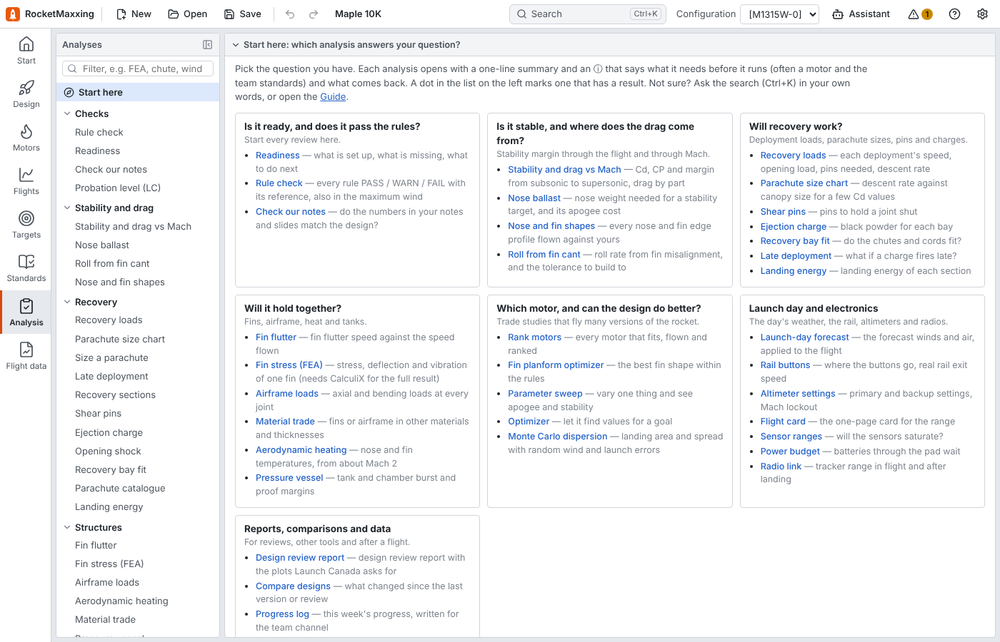

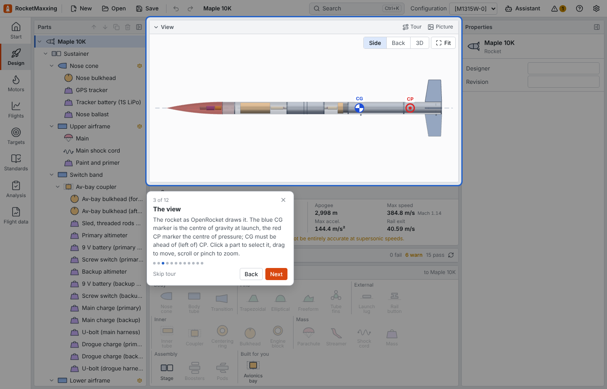

## Pages

| RocketMaxxing | OpenRocket | Notes |
|---|---|---|
| Design | Rocket design | Parts list on the left, the rocket in the middle, the selected part's properties on the right (no pop-up dialog). The add-part buttons are below the view; the ones that can't go where you are pointing are greyed out. Summary shows stability against your rule set's minimum, mass, length and a quick flight of the active configuration. Fins show their outline (freeform fins are drawn and edited there); parts with a catalogue have a Catalogue button; every part can be given a paint colour. Parts move by dragging in the list or along the rocket in the view (lining up with their neighbours), and the view has an exploded mode (see below). Picture makes an exploded, cut-away or outside 3-D image with a numbered parts list, or the side drawing with CG and CP. The Avionics bay button lays out a whole electronics bay between two tubes. |
| Motors | Motors & Configuration | Motors, recovery and stages as three tables on one page, a row per flight configuration. The motor list is OpenRocket's own database (the thrustcurve.org motors that come with OpenRocket 24.12, offline): it can be searched, filtered to motors that fit the mount, and shows the thrust curve. Import file adds a .eng, .rse or zipped motor file; Your own motor makes one from static-fire data (a thrust curve to paste or load from CSV, or an average thrust and burn time) with its masses, delays and CG. Both are kept in the designs folder's `motors/` and load whenever the app starts, so a design keeps its motor. |
| Flights | Flight simulations | The simulations, the launch conditions of the selected one, and its plot. Video turns the selected flight into an animation (a chase camera, the separations and canopies, the numbers on screen): a GIF, an MP4 when ffmpeg is installed, and a sheet of key-moment stills. |
| Standards | (not in OpenRocket) | The team's standards, which every check uses: the competition rule set, the launch site, recovery and structures safety factors, shear pin ratings, material data, altimeter, battery and radio settings. Only what the team changes goes into its file (`openrocket-mcp.json`); a dot marks those values, and each can go back to its default. |
| Targets | (not in OpenRocket) | The team's targets: a minimum, goal and maximum for apogee, speeds, rail exit, stability, flutter margin, mass, descent rates, landing and more, each with the margin to the nearer limit (met, close within 5%, missed), checked again after each edit. The competition rules sit beside them. |
| Flight data | (not in OpenRocket) | After a flight: load the altimeter log and see it against the simulation flown in the day's conditions, with the drag factor that matches the measured apogee. Read a folder of past rockets and logs to see how well apogee was predicted over the years, and open or compare any of them. |
| Analysis | (not in OpenRocket) | 50 analyses from the engine, by area: rule check, readiness, checking meeting notes against the design, Launch Canada probation level; stability and drag vs Mach, ballast, shape trades; recovery loads, parachute sizing, late deployment, shear pins, ejection charge, opening shock, bay fit, parachute catalogue, landing energy; fin flutter, fin stress (FEA with CalculiX), airframe loads, heating, material trade, pressure vessel; avionics bay, launch-day forecast, rail buttons, flight card, altimeter settings, sensors, simulated sensor data for flight software, radio link, power budget, winds aloft; Monte Carlo, motor ranking, parameter sweep, fin planform optimizer, optimizer; part from a shop link, compare designs, progress log, edit history, RASAero table import, flight log against the simulation; report, CSV and geometry export. Pick one, fill in what it asks for (simulation, parts and other designs from lists, files with Browse, lists of items as small tables), run. Results show as tables with pass, warn and fail in colour, plots, and a Show button for files it writes. |

Every panel and section folds (click its title). The Parts and Properties panels fold to a strip at the side to give
the view more room. What is folded is remembered.

### RASAero beside OpenRocket

OpenRocket's drag and centre of pressure are least sure between Mach 0.8 and 1.2, and Launch Canada asks for RASAero's
CP and CD when the airframe's diameter changes. When the active configuration's flight reaches Mach 0.8, or a RASAero
table is imported, the Design page shows a **RASAero vs OpenRocket** panel:

- With no table: the flight's top Mach, OpenRocket's CD through Mach, and **Import RASAero CSV**: the file RASAero II
  exports from its aero data (Mach, Alpha, CD, CD Power-Off, CD Power-On, CP, with CP in inches from the nose tip).
- With a table: the flight on both models side by side (apogee, top speed, top Mach, time to apogee, rail exit,
  lowest stability with each model's CP) and the difference, flagged from 5% (or 0.5 cal); CD against Mach for
  OpenRocket and RASAero (power off and on); and CD and CP by Mach from both, Mach 0.8 to 1.2 shaded. Replace or remove
  the table from the panel.

Once imported, the table's drag is used in every flight of the design (quick flight, Flights, targets, analyses; the
Summary's apogee says "RASAero drag") and its CP in the rule check; the panel's OpenRocket column is the same flight on
OpenRocket's own drag. The table is saved next to the design (`rocket.aero.json`). On a staged rocket, the sustainer's
own run goes in from Analysis › RASAero aero table, by stage. RASAero II itself is a separate Windows program:
RocketMaxxing reads its exported file rather than running it.

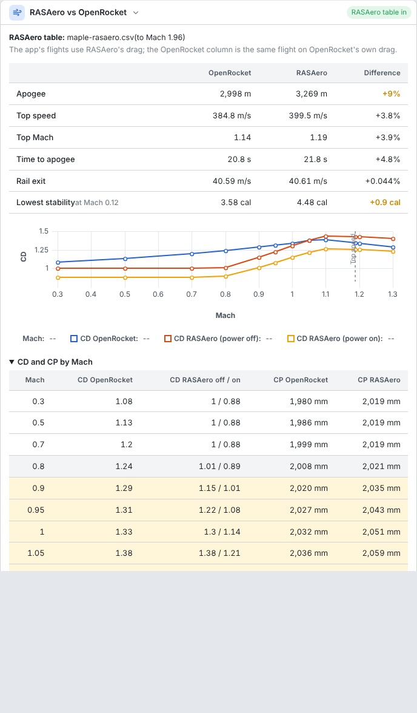

### Right-click

Right-click anything for its quick commands; empty space gives the page's own and the app's (search, undo, redo,
save, the Guide, settings). Text boxes keep the system's menu (cut, copy, paste). The menu works with the arrow keys
and Enter.

| Page | Right-click on | Commands |
|---|---|---|
| Start | a recent file, an example | open, show in its folder, copy its path, remove from the list, clear the list |
| Design | a part (list or view) | rename, duplicate, copy, paste into it, move up or down, line up at the front, middle or back of its parent, weighed mass, delete; in the list also fold and unfold what is inside |
| Design | the view | Side, Back, 3D, Exploded, Cut-away, Fit, picture or drawing |
| Design | Properties, a setting | find a setting, fold or unfold all sections, catalogue parts, default colour; a list setting's choices, Automatic, copy the value |
| Design | an Add part tile, Summary, Rule check | add (and rename); copy the numbers, the analyses behind them; check again, copy the results, show passes, automatic checking, the rule set |
| Motors | a configuration, a motor, a deployment, a separation | make active, rename, copy, delete; change or remove the motor, its ejection delay, the same motor in every configuration, rank motors; deploy at apogee or at an altitude, edit for every configuration, size the parachute, recovery loads |
| Flights | a simulation, the plot | run, video, rename, make its configuration active, export, Monte Carlo, delete; plot presets, copy the plotted data as CSV |
| Targets | a target | goal, minimum or maximum = where the design is now, clear, copy the line, copy all targets |
| Standards | a value, a table row, a list row | back to the default, copy; remove; duplicate, move, remove; go to a section, show the standards file |
| Analysis | an analysis, the form, the result | open, run with these inputs, clear its inputs or result, fold or unfold the groups; run; copy the result, run again |
| Flight data | a past design | open, compare with the open design, show in its folder, copy its path; choose a log or folder, read the folder |

Every panel title also folds that panel, the other panels, or unfolds them all.

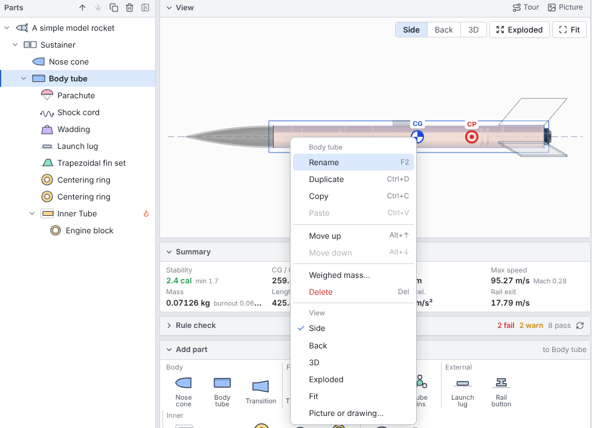

### Moving and lining up parts

- **In the parts list**, drag a part onto another to put it inside (the row is outlined), or between two rows to place
  it there (a line shows where). A folded row held under the pointer unfolds. Only places the part can go light up: a
  parachute goes into a tube, not into the stage. Alt+↑ and Alt+↓ move the selected part up or down; the arrow keys
  walk the list (→ unfolds, ← folds or goes to the parent, F2 renames).
- **Right-click** a part for Rename, Duplicate, Copy, Paste, Move up, Move down and Delete. Copy and paste
  (Ctrl+C, Ctrl+V; ⌘C, ⌘V on a Mac) put a copy, with everything inside it, into the selected part, where Add part
  would put a new one. Delete says what it removed; Ctrl+Z brings it back.
- **In the view**, point at a part to see its name; drag the selected part to slide it along the rocket. Its front,
  back or middle snaps to the edges of its parent and of the parts beside it, with a line where they meet and a
  readout of how far it moved ("Back lines up with the back of Upper airframe"). Hold Alt to place it freely. Body
  tubes, nose cones and transitions follow one another, so they are reordered in the list instead.
- **Properties › Position › Line up** puts the part at the front, middle or back of the part it is in, in one step.
- **Number boxes** step with ↑ and ↓ (Shift: ten times more, Alt: ten times less). The **Find a setting** box at the
  top of Properties shows any setting of the part by name, folded sections included.

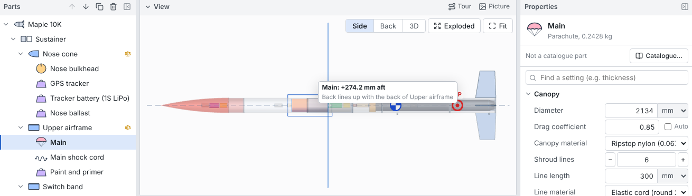

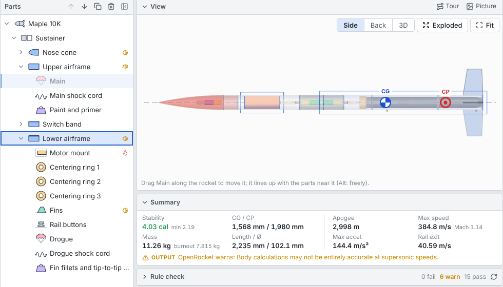

**Exploded** in the view's bar pulls the rocket apart: the sections along the axis, the fins out from the tube, and
the parts inside laid out in rows under their section. The slider sets how far; pointing at a part names it, and the
selected part has a dashed line back to where it is installed. It works in the side and 3-D views and can be asked
for from the search (Exploded view). The 3-D view is lit like a photo studio, with a shadow under the rocket and
paint shine; Fit frames the whole rocket in every view.

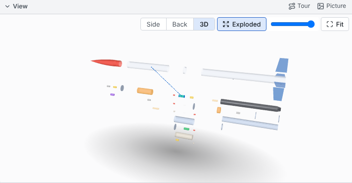

The Design page has a Rule check panel: the competition rule check runs again a moment after each edit, and its title
shows the fail, warn and pass counts even when it is folded. It can be turned off in Settings.

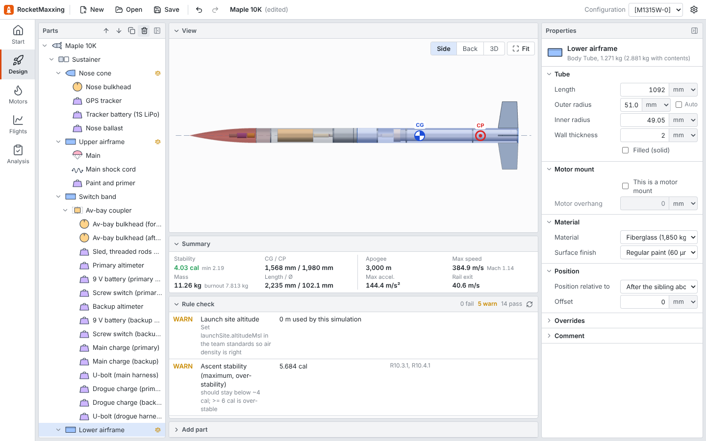

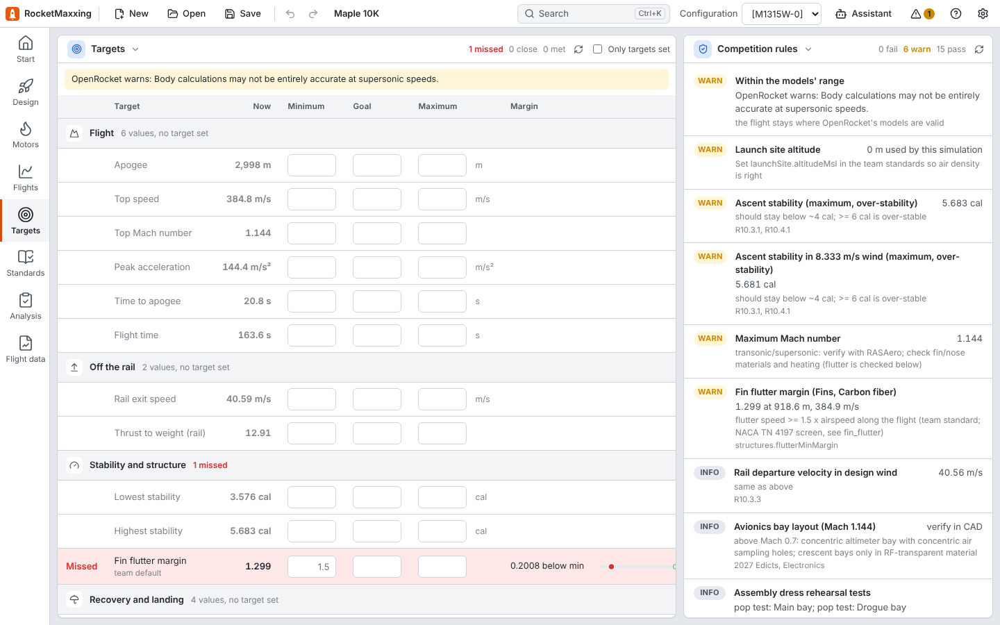

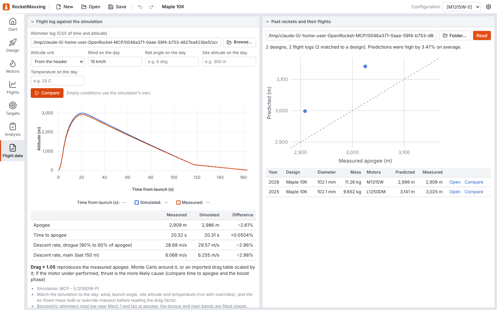

Freeform fins are edited in the Properties panel: drag a point, double-click an edge to add one, select a point and
press Delete to remove it, or type the coordinates. Trapezoidal and elliptical fins can be converted to freeform. Parts
that come in catalogues (tubes, nose cones, couplers, rings, rail buttons, parachutes...) open OpenRocket's parts
database, nearest the part's diameter first.

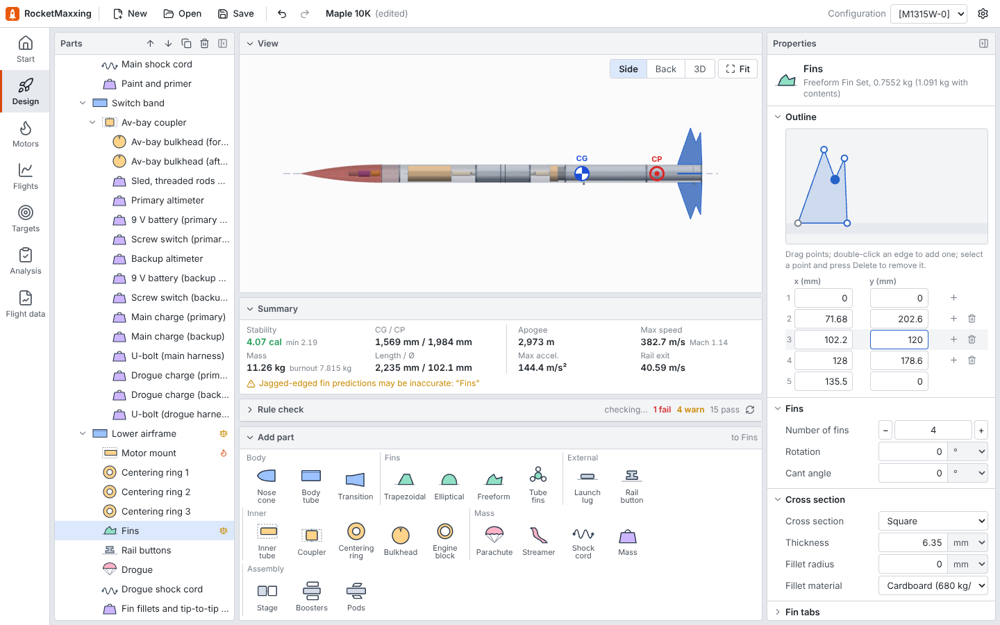

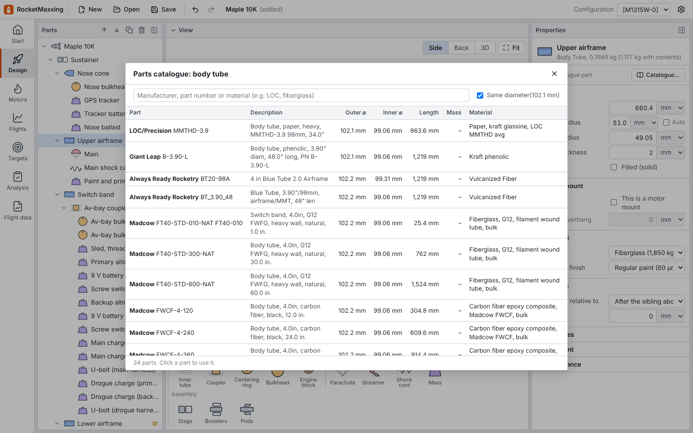

Pictures, drawings and videos go to the designs folder's `exports/`, and show in the app as soon as they are made. None
of them needs an assistant.

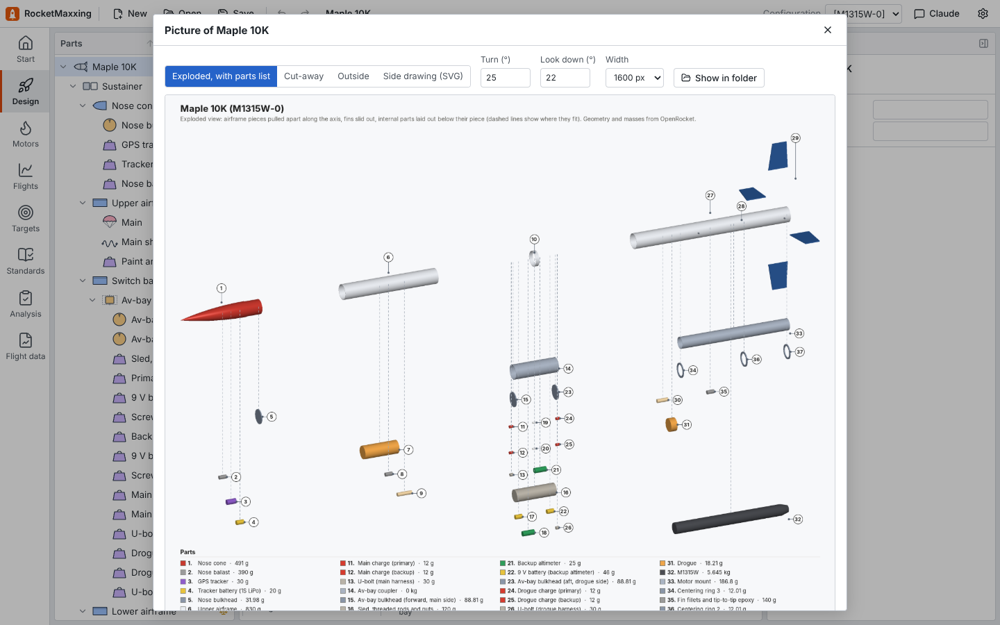

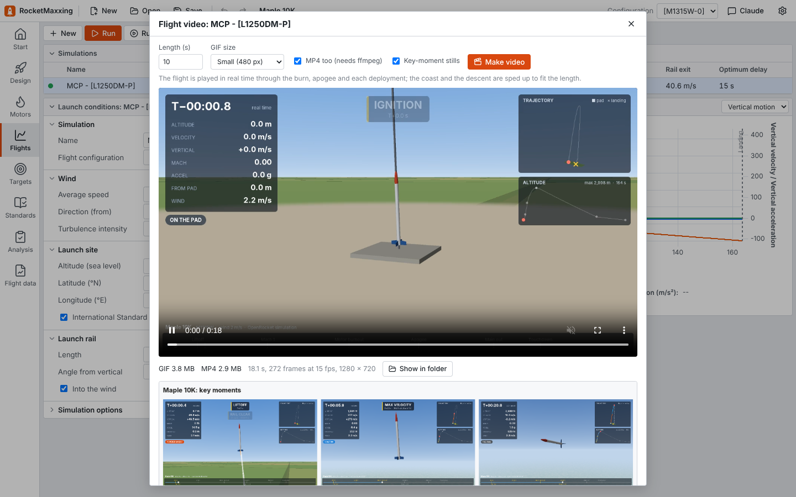

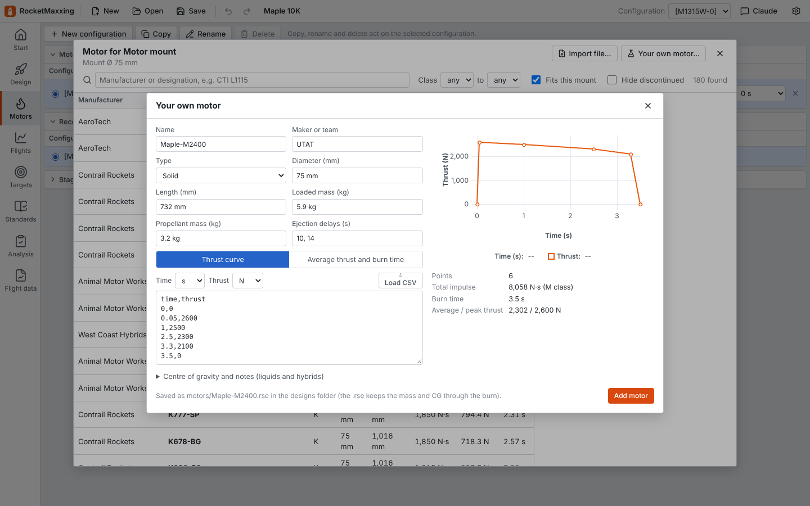

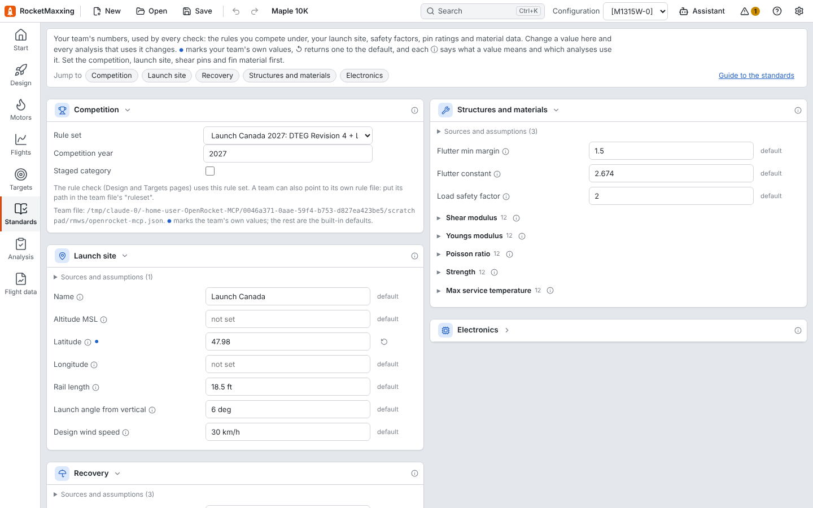

Plots in Analysis: stability and Cd against Mach, the parameter sweep, late deployment, the parachute size chart,
the Monte Carlo landing map and the flight log against the simulation.

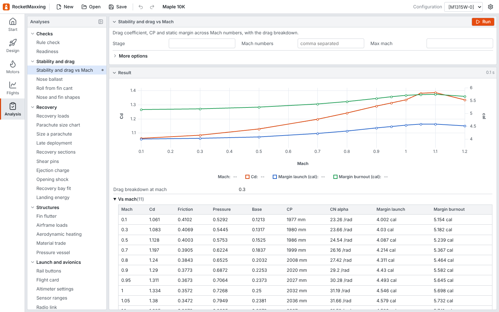

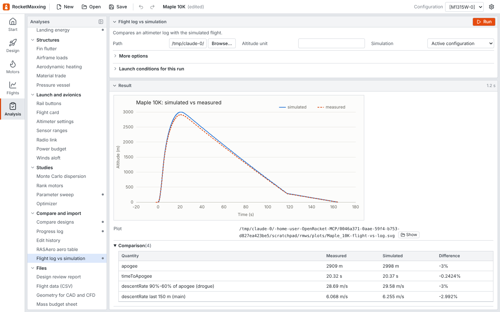

Search (top bar, or ⌘K on a Mac and Ctrl+K elsewhere) finds anything by its name or by what it is for: an analysis
(FEA, Ansys or stress finds Fin stress; chute size finds the parachute sizing; black powder finds the ejection
charge), a page, an action such as Save or Choose a motor, a part to add (with where it would go), a part of the open
design (it is selected), or a setting (dark theme, imperial units, a colour scheme, the AI assistant). A word one
letter off still matches. The Analyses list has its own filter box for the analyses alone.

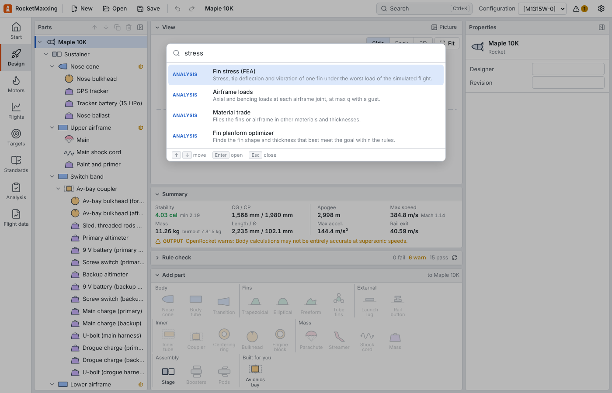

Each analysis has an ⓘ beside its one-line summary. It says what to have ready before running it (a motor, the
parachutes' deployment, material constants, CalculiX for the fin FEA), what the result holds, how it is worked out,
what it is not (the fin FEA is one clamped plate under a uniform pressure, not a model of the build), and an example
with numbers. Each input has its own ⓘ: what it means, an example in your unit system, what is used when it is left
empty, and the unit a bare number is read in (a wind direction of 270 is 270 degrees, the direction the wind blows
from). The boxes show an example (e.g. 270 deg, e.g. 20 km/h). Inputs marked * are needed; where any one of a few
will do (the bay's tube, diameter or volume for the ejection charge), each is marked and the line under the form says
so. Shear pins are picked from the team standards' list. An analysis that reads the flight says so when the
configuration has no motor, with a link to the Motors page, instead of running on an empty flight.

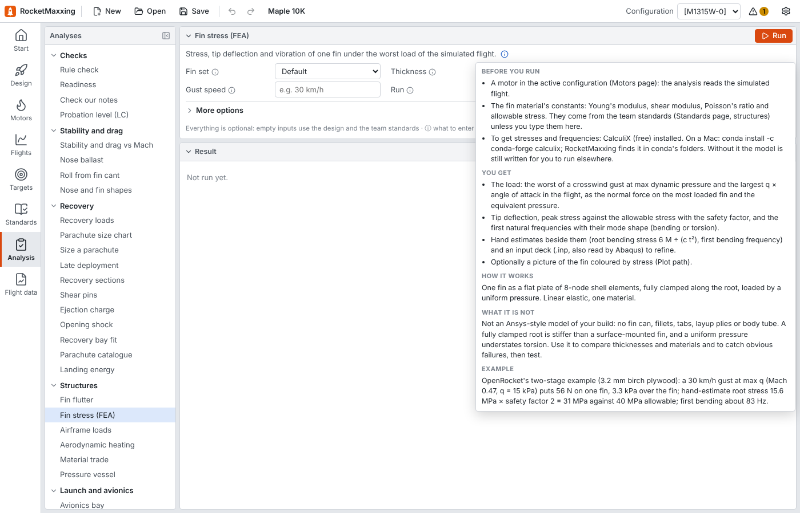

Analysis results are kept while the app is open and dimmed when the design has changed since they ran. Results
that are text from the engine follow the metric or imperial setting, but not the per-quantity units.

The view has three modes. Side is OpenRocket's figure, with the airframe see-through and CG and CP marked. Back looks
along the rocket from behind. 3D can be turned, and Cut-away opens the airframe. Click a part to select it.

The selected part is tinted and the rest dims; in Side and Back a box marks it, and in 3D a part inside the airframe
shows through it even without Cut-away. Selecting a stage or pod set marks everything in it. Pointing at a part in
the list, or at a tile under Add part, marks that part (for a tile: the part the new one goes into) with a fainter
box. A new part is selected, pulses in the view and flashes in the list. The wheel or a trackpad pinch zooms toward
the pointer, eased and within limits, so a fast flick does not throw the view about.

Settings (the gear, top right) has the units, metric or imperial and per quantity, and the appearance: light, dark
or the system's, and a colour scheme for the navigation rail, the top bar, the accent and the selection (Launch,
Nebula, Afterburner, Sunburst, Aurora, Deep sea, Rose, Midnight, Graphite), after the way Slack offers themes. Two
schemes are for colour vision: Red–green safe (protanopia, deuteranopia) and Blue–yellow safe (tritanopia) also
change the pass, warning and failure colours to ones that stay apart.

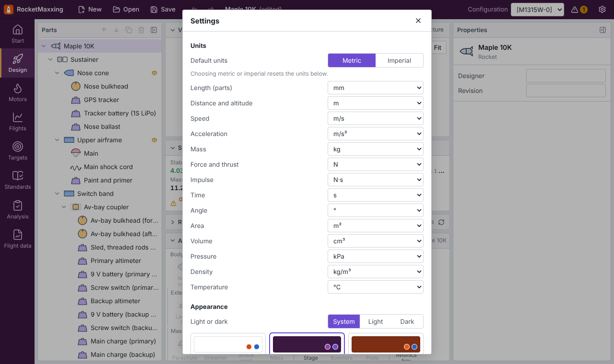

### Problems

Every error and warning says whose problem it is:

| Kind | Means | Where it shows |
|---|---|---|
| Input | Something in what was asked can't be used: a value, a unit, a name. | The pop-up, the field in the Analysis form (marked red), the result. |
| Physics | The rocket or its flight: it doesn't lift off, tumbles, never reaches apogee; OpenRocket's own warnings (large angle of attack, a gap in the airframe, fins too thick for its model). | Under the Design summary after every edit, the result, the Flights table (a warning sign on the run), the rule check. |
| Output | A result to treat with care: a value that could not be computed, or one from beyond where the model is valid (past Mach 3; OpenRocket's body calculations past Mach 1). | Under the Design summary, the result, the rule check ("Within the models' range"). |
| System | Something on this computer or in RocketMaxxing failed, not the design: no internet, a file that can't be written, a program not installed, or a bug. | The pop-up and the result. |

The warning sign at the top right opens the Problems list: what to watch in the current design's flight, then
every error since the app started, newest first, with where it happened. It is red when there are errors you haven't
looked at, amber when the flight has something to watch. A bug in RocketMaxxing (in the engine or in the window)
comes with an error ID and a report: Copy report, Save report, or Report on GitHub, which opens a new issue with the
report filled in for you to read and send. The report has the versions, what was asked and where it failed, but not
the design. The engine's log has the same error ID next to the full trace.

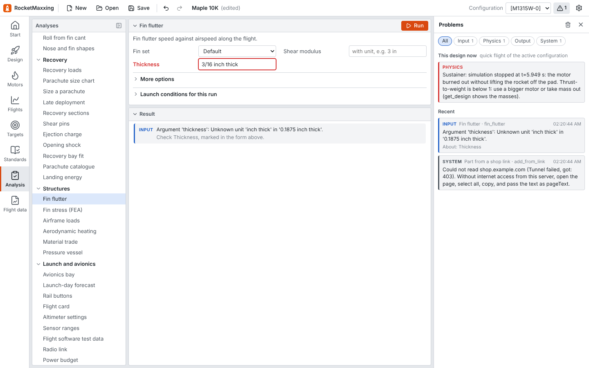

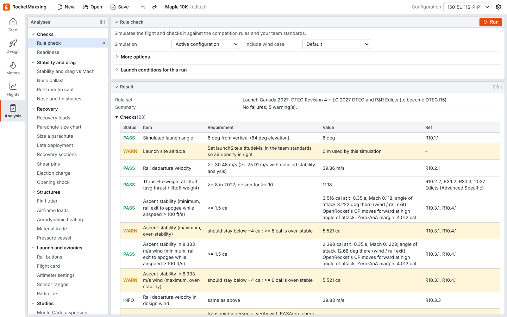

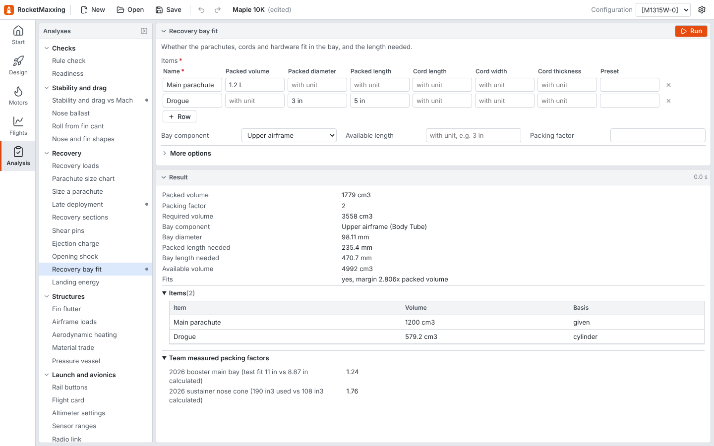

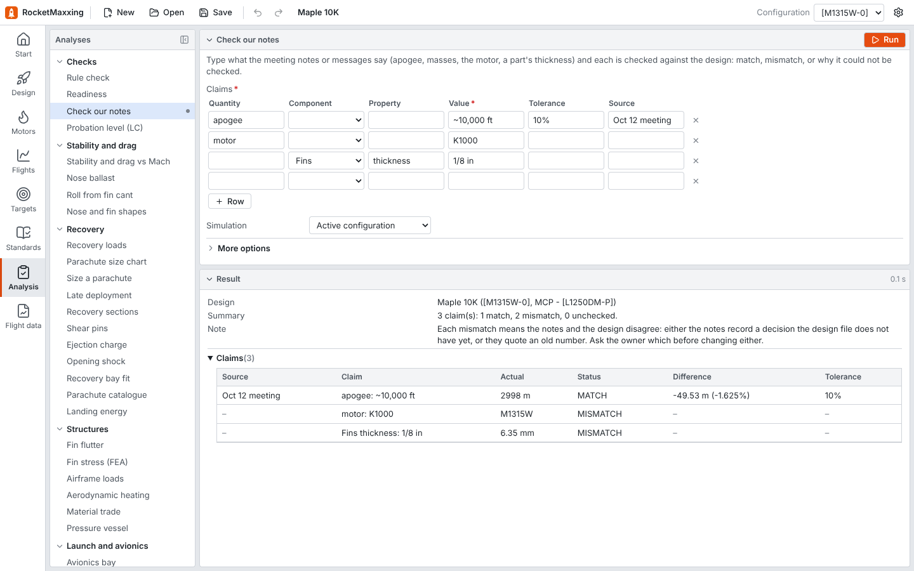

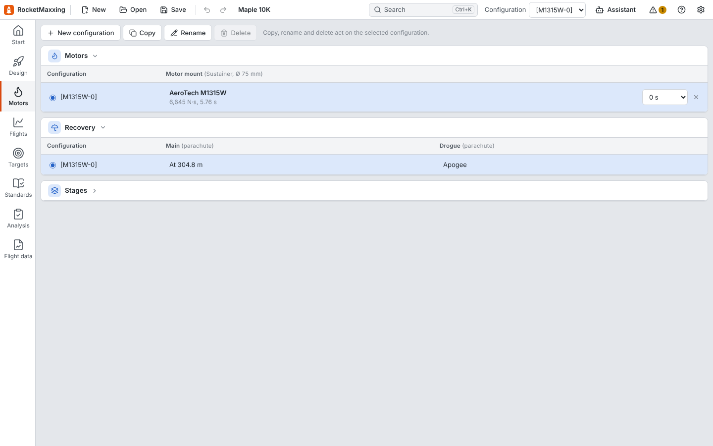

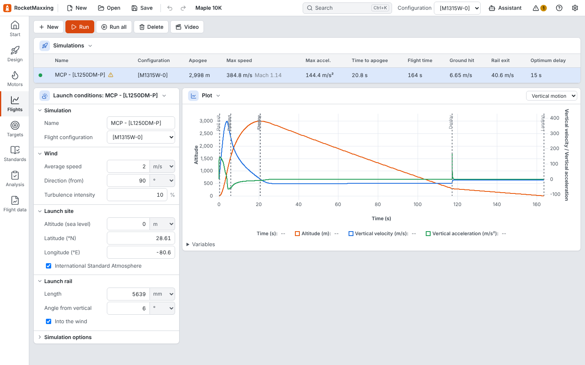

Edits can be undone (up to 50). Nothing is written to the file until you save.

While the engine works (starting up, a long analysis, a video), a small rocket flies past whatever happens to be up
there (geese, an airliner, a kite, the Moon, a satellite, a UFO...) and says what it is up to.

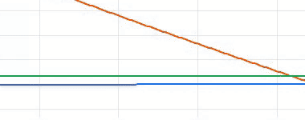

## The assistant (optional)

The robot button at the top right (Assistant, or Claude or Codex once connected) opens the assistant beside the
design. Until it is connected the panel shows the setup: choose one of the three ways below, and it says whether Claude
Code and Codex are installed and signed in on this computer and what is still needed; Start opens the conversation.
The sliders button in the panel's header comes back to the setup, and Settings > AI assistant has the same choices
(and turns it off). It works through the same tools as the app (and as the MCP server), so what it changes shows at
once and undoes like any other edit; each tool it used can be opened to see what it sent and got back. It is off until
you choose a way to connect:

| Connect with | What you need | Billing |
|---|---|---|
| **Claude subscription** | [Claude Code](https://claude.com/claude-code) installed and signed in (run `claude` once in a terminal and log in with your Claude Pro or Max account) | your plan's usage limits |
| **ChatGPT subscription** | [Codex](https://github.com/openai/codex) installed (`npm i -g @openai/codex`) and signed in (`codex login`) | your plan's usage limits |
| **Anthropic API key** | a key from the Anthropic Console, pasted in Settings (or `ANTHROPIC_API_KEY`) | per use, on your API account |

For Claude Code and Codex, RocketMaxxing runs the tool you already have on each message, headless, and lends it the
app's tools through a private MCP endpoint on `127.0.0.1` with a new random token. Claude Code runs without its own
tools (no shell, files or web) and Codex in its read-only sandbox, so they work only through RocketMaxxing's tools. The
sign-in stays with Claude Code or Codex; RocketMaxxing never sees it. Settings shows whether each is installed and
signed in (from `claude auth status` and `codex login status`) and lets you pick the model: Claude Code's aliases
(opus, sonnet, haiku) or its default, Codex's default or a model you name. A second message continues the same Claude
Code session or Codex thread. The app looks for the tools on PATH and where their installers put them; set
`ROCKETMAXXING_CLAUDE` or `ROCKETMAXXING_CODEX` to point at a particular one.

With an API key, the model can be Claude Opus 5.5 (the default), or Claude Sonnet 5.5 or Haiku 5.5 for lower cost, and
the key is kept in `~/.rocketmaxxing/assistant.json` (readable only by you on macOS and Linux), never in the designs
folder.

Whichever way, your messages, the open design's data and the tools' results go to Anthropic (Claude Code, API key) or
OpenAI (Codex).

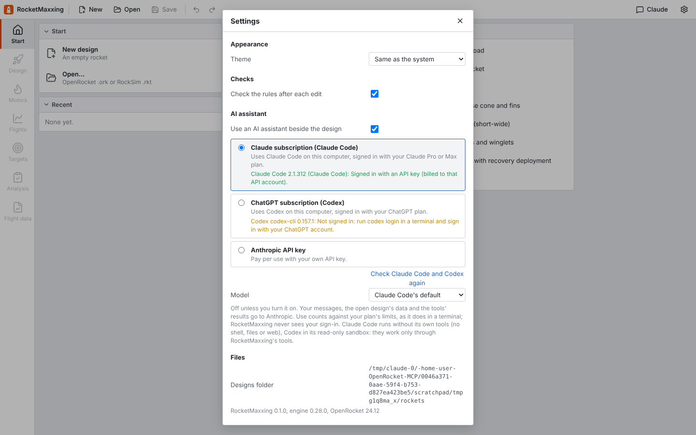

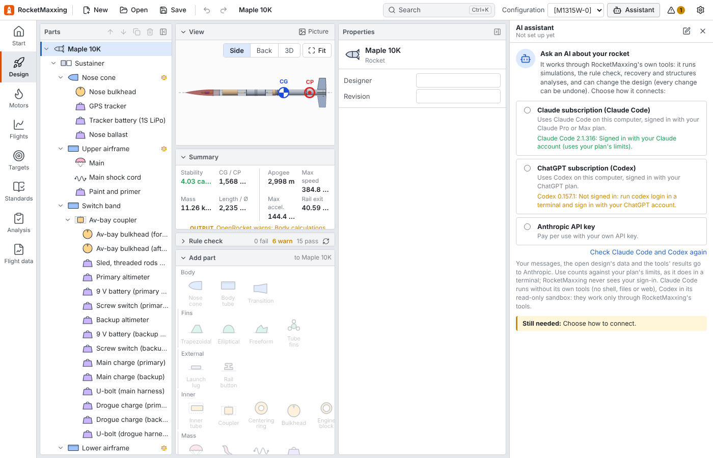

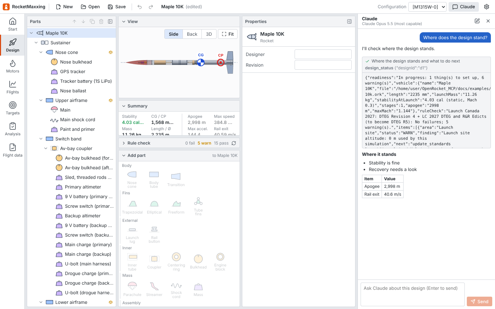

| Keys (⌘ instead of Ctrl on a Mac) | |
|---|---|
| Ctrl+K | Search for anything: an analysis, a page, a part, a setting |
| Ctrl+Z, Ctrl+Y or Ctrl+Shift+Z | Undo, redo |
| Ctrl+S, Ctrl+Shift+S | Save, save as |
| Ctrl+O | Open |
| Delete | Delete the selected part |
| Ctrl+C, Ctrl+V, Ctrl+D | Copy a part, paste it into the selected part, duplicate |
| Alt+↑, Alt+↓ | Move the selected part up or down |
| ↑ ↓ ← → in the parts list | Walk the list; → unfolds, ← folds or goes to the parent; F2 renames; Enter goes to its settings |
| ↑ ↓ in a number box | Step the value (Shift: ten times more, Alt: ten times less) |
| Alt while dragging a part | Place it without lining it up |
| Right-click | The commands for what is under the pointer |

Sizes can be typed with a unit, e.g. `3 in` in a millimetre field.

## Install and run

RocketMaxxing runs on macOS (Apple Silicon and Intel), Windows and Linux. Installers with Java included are built per
platform: `./gradlew rocketmaxxingInstaller` makes a `.msi` on Windows (needs WiX 3), a `.dmg` on macOS and a `.deb` on
Linux (needs `fakeroot`) in `build/installers/`; `-PinstallerType=app-image` makes a folder that runs without
installing. The *RocketMaxxing installers* workflow builds all four (two for the Mac) on every push to `main` and to
the working branches, after starting each packaged app and using it; the installers are the run's artifacts.

### On a Mac

1. On GitHub, open **Actions**, then **RocketMaxxing installers**, then the latest green run, and download
   `rocketmaxxing-macos-apple-silicon-dmg` (M1 and later; Apple menu > About This Mac says "Apple M...") or
   `rocketmaxxing-macos-intel-dmg`. Unzip it to get `RocketMaxxing-0.1.0.dmg`. If a run has no Apple Silicon one
   (GitHub sometimes has no Apple Silicon machine free to build it), the Intel one also runs on Apple Silicon Macs,
   through Rosetta.
2. Open the `.dmg` and drag RocketMaxxing into Applications.
3. The app is not signed with an Apple developer certificate yet, so the first time macOS refuses to open it. Open it
   once, then in **System Settings > Privacy & Security** click **Open Anyway** next to "RocketMaxxing was blocked",
   and confirm. Or, in Terminal: `xattr -dr com.apple.quarantine /Applications/RocketMaxxing.app`. After that it opens
   like any other app.
4. It opens in Chrome or Edge in app mode if one is installed, otherwise in Safari. Designs go in `~/RocketMaxxing`.

On the Mac, RocketMaxxing lives in the Dock; its window is a browser's, so the menu bar at the top shows the browser's
menus while you work in it. Clicking the Dock icon brings the window back (closing the window keeps the app running,
as Mac apps do), and the Dock icon's menu and RocketMaxxing's own menu bar (shown when you click the Dock icon) have
Show RocketMaxxing Window and Open Design (⌘O). About and Quit are in the RocketMaxxing menu; Quit asks first when a
design has unsaved changes. Double-clicking an `.ork` or `.rkt` file in Finder opens it in RocketMaxxing (or use
Open With). Shortcuts are shown as ⌘ and work with Cmd: ⌘S, ⇧⌘S, ⌘O, ⌘Z, ⇧⌘Z.

### One app, one window

On every system there is one RocketMaxxing per designs folder. Starting it again, or double-clicking a design while it
runs, hands over to the running app instead of starting a second one, and a new window opens with the design; the
older window steps aside (it closes, or says to use the new one), since a browser window cannot be brought to the
front from outside. Everything open stays open, and the new window returns to the page you were on. On Windows and
Linux the installers also register `.ork` and `.rkt`, and the app stops two minutes after its window is closed.

Optional extras are found where Homebrew, MacPorts or conda put them, even though an app started from the Dock does
not see the Terminal's PATH: `brew install ffmpeg` for MP4 videos, CalculiX (`conda install -c conda-forge calculix`)
for the fin FEA, and Claude Code or Codex for the assistant.

To run from source: Java 17 or newer. Building the interface the first time also needs Node.js 20 or newer.

```bash
git clone https://github.com/TheCheng2005/RocketMaxxing.git
cd RocketMaxxing
./gradlew rocketmaxxing
build/install/openrocket-mcp/bin/rocketmaxxing        # Windows: build\install\openrocket-mcp\bin\rocketmaxxing.bat
```

The app opens in its own window (Chrome or Edge in app mode if installed, otherwise your default browser). The file
dialogs start in `~/RocketMaxxing`. On Windows and Linux the app quits two minutes after its window is closed; on the
Mac it stays in the Dock until you quit it.

| Option | |
|---|---|
| `--workspace DIR` | Designs folder (default `~/RocketMaxxing`) |
| `--port N` | Local port (default: any free one) |
| `--no-browser` | Print the address instead of opening a window |
| `--dev URL` | Also accept calls from a development server |
| `FILE.ork ...` | Designs to open (a running RocketMaxxing for the same folder opens them) |

## How it works

```
 window ──POST /rpc (token)──► local server, 127.0.0.1 only ──► the engine's tools ──► OpenRocket 24.12
```

- The launcher starts the engine on `127.0.0.1` with a new random token and opens the window with that token, so other
  programs and web pages on the computer can't use it.
- The window calls the engine's ordinary tools (`open_design`, `add_component`, `set_motor`, `undo`, `save_design`, ...)
  and a few app-only ones (`app_*`) that return plain SI numbers. The MCP server doesn't register the `app_*` tools.
- Edits go through the same property code as the chat tool `edit_components`.
- Speed: the engine starts in about a second (OpenRocket's plugins are registered from a list instead of a scan of
  every jar), loads the motor and parts databases side by side, then flies a built-in example in the background so
  the first real flight is warm. After an edit the design is flown once for the quick flight, the rule check and the
  targets (the maximum-wind case is reused until the flight changes), and only the parts whose shape changed are
  sent to the window, which keeps the 3-D geometry of the others. Each page's code loads when it is first shown.

Code:
- `src/main/java/io/github/openrocketmcp/app/`: launcher, local server, app tools, part editors, the assistant.
- `app/`: the interface (Svelte 5, TypeScript, three.js, uPlot).

## Development

```bash
./gradlew installDist
build/install/openrocket-mcp/bin/rocketmaxxing --port 47801 --dev http://localhost:5173 --no-browser
cd app && npm install && npm run dev
```

Open the address the engine prints (`http://localhost:5173/#token=...`). `npm run check` type-checks the interface.
`npm run build` first checks that no two files' names differ only in capitals (`scripts/check-names.mjs`): macOS and
Windows treat those as the same file, and the Mac and Windows builds broke on that once.
`AppToolsTest` covers the app tools and the local server, `AssistantTest` the assistant against a stand-in for the API,
`AgentCliTest` reading Claude Code's and Codex's output, `scripts/test_app_agents.py` the assistant through the real
Claude Code and Codex with stand-in models, and `scripts/test_rocketmaxxing.py` starts the installed app
and uses it.

## Not in RocketMaxxing yet

Use OpenRocket on the same file for:
- decals and textures, the photo studio, fin templates, printing;
- custom plot setups (the Analysis page exports flight data);
- importing a fin outline from an image or a CSV file.

Every engine analysis is now on the Analysis page. Two need something outside the app: the fin FEA runs CalculiX
when it is installed (otherwise it writes the model to run elsewhere), and the launch-day forecast needs internet
access to Open-Meteo (offline, paste Open-Meteo's JSON into the form). A product link works offline the same way:
paste the page's text.
