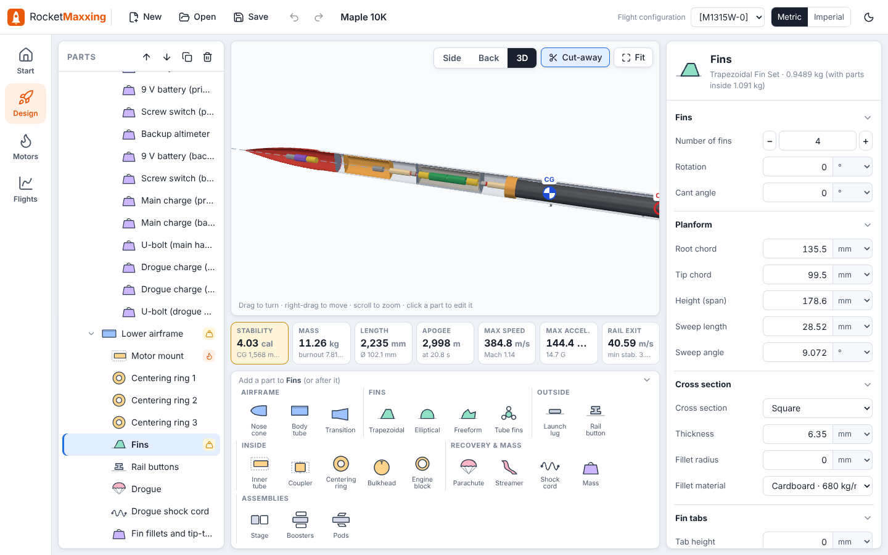

# RocketMaxxing

RocketMaxxing is a desktop app for designing and flying competition rockets. It runs on your own computer with no
internet connection and no AI subscription. Inside is the same engine as the OpenRocket MCP server: OpenRocket 24.12
for the physics, plus this project's tools. Your designs stay ordinary OpenRocket `.ork` files, so you can switch
between RocketMaxxing and OpenRocket whenever you like.

**Status: first version (0.1.0).** It covers OpenRocket's three main tabs with a cleaner layout. The extra engineering
tools (rule checks, recovery, structures, avionics, Monte Carlo...) come next. See [the plan](APP_PLAN.md).


## What is where

The app has the same three pages as OpenRocket's tabs. Each one is laid out so you rarely open a separate window.

| RocketMaxxing | OpenRocket | What changed |
|---|---|---|
| **Design** | Rocket design | The part editor stays open on the right instead of a pop-up dialog. Sizes take any unit (type `3 in` into a millimetre box). The add-part buttons are bigger, grouped by family, and greyed out where a part can't go. Click a part in the view to edit it. The live numbers sit under the view: stability (green, amber or red), mass, length, apogee, max speed, acceleration and rail exit speed. |
| **Motors** | Motors & Configuration | The motors, recovery and stages tabs share one table: a row per flight configuration, a column per mount, parachute or stage. The motor picker searches as you type, shows the thrust curve and only lists motors that fit the mount. |
| **Flights** | Flight simulations | The launch conditions are a form next to the plot, so there is no dialog to open and close. One-click plot presets cover vertical motion, stability, drag and forces, with launch, burnout, apogee and deployment marked on the plot. |


The view has three modes. **Side** is OpenRocket's figure: the airframe is see-through so the inside shows, with CG and
CP marked. **Back** looks along the rocket from behind. **3D** is a model you can turn, with a cut-away that opens the
airframe.



Every change goes through the engine and can be undone (Ctrl+Z, up to 50 steps). Nothing is written to your file until
you save.

| Keys | Does |
|---|---|
| Ctrl+Z / Ctrl+Y (or Ctrl+Shift+Z) | Undo / redo |
| Ctrl+S / Ctrl+Shift+S | Save / save as |
| Ctrl+O | Open a design |
| Delete | Remove the selected part |

## Install and run

You need Java 17 or newer. To build the interface you also need Node.js 20 or newer, but only the first time.

```bash
git clone https://github.com/TheCheng2005/OpenRocket_MCP.git
cd OpenRocket_MCP
./gradlew rocketmaxxing
build/install/openrocket-mcp/bin/rocketmaxxing        # Windows: build\install\openrocket-mcp\bin\rocketmaxxing.bat
```

The app opens in its own window. If Chrome or Edge is installed it uses that browser's app mode; otherwise it opens a
tab in your default browser. Designs go in `~/RocketMaxxing` unless you open them from somewhere else. The app stops
two minutes after you close its window.

| Option | Use |
|---|---|
| `--workspace DIR` | Folder for designs (default `~/RocketMaxxing`) |
| `--port N` | Local port (default: any free one) |
| `--no-browser` | Don't open a window; print the address instead |
| `--dev URL` | Also accept the development server (see below) |

## How it works

```
 browser window ──POST /rpc (token)──► local server on 127.0.0.1 ──► the same tools Claude calls ──► OpenRocket 24.12
```

- The launcher starts the engine on `127.0.0.1` only, with a new random token each time, and opens the window with
  that token. Other programs and web pages on the computer can't use the engine.
- The window calls the engine's ordinary tools (`open_design`, `add_component`, `set_motor`, `undo`, `save_design`...)
  plus a few that only the app registers (`app_*`). Those give the window plain numbers in SI units; it shows them in
  your units. The MCP server for Claude doesn't include the `app_*` tools.
- Edits use the same property code as Claude's `edit_components`, so the app and a chat change a design in exactly
  the same way.

The code lives here:
- `src/main/java/io/github/openrocketmcp/app/`: the launcher, the local server, the app tools and the part editors.
- `app/`: the interface (Svelte 5, TypeScript, three.js for 3-D, uPlot for plots).

## Development

```bash
./gradlew installDist
build/install/openrocket-mcp/bin/rocketmaxxing --port 47801 --dev http://localhost:5173 --no-browser
cd app && npm install && npm run dev
```

Open the development address the engine prints (`http://localhost:5173/#token=...`). The page reloads as you edit the
interface. `npm run check` type-checks it. The engine's own tests cover the app tools and the local server
(`AppToolsTest`).

## Not yet in RocketMaxxing

For these, open the same file in OpenRocket for now:
- Editing freeform fin points, and the component preset (catalogue part) browser. The engine already does catalogue
  parts: `search_parts` / `apply_preset`.
- Appearance and decals, the photo studio, fin templates and printing.
- Custom plot configurations and exporting flight data. The engine already exports: `export_flight_data`.
- OpenRocket's optimiser and component analysis windows. The engine already has these, and they're on the way to the
  app: `optimize`, `sweep`, `aero_analysis`.
- Installers with Java included. For now the app runs from the build folder. Installers are next.
