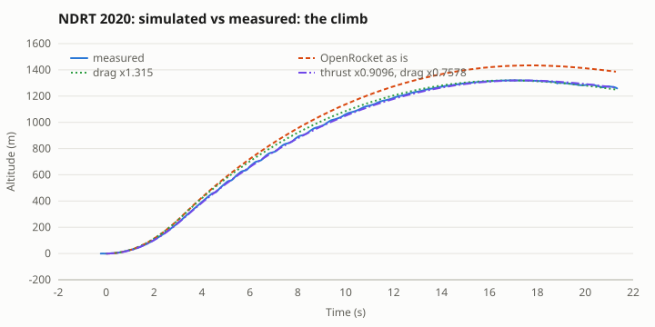
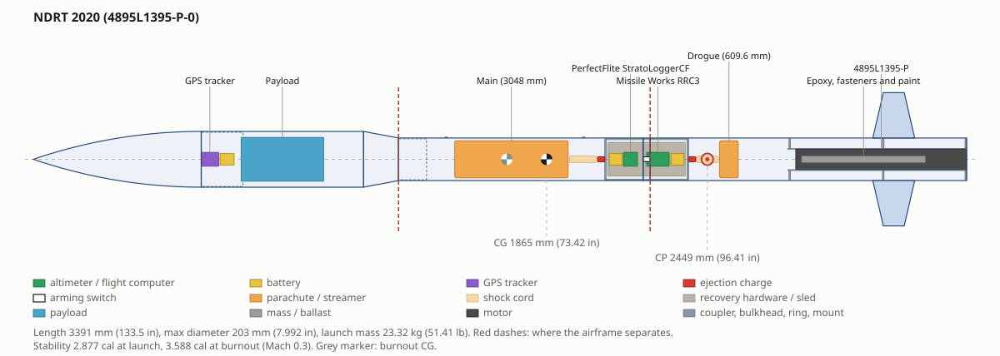
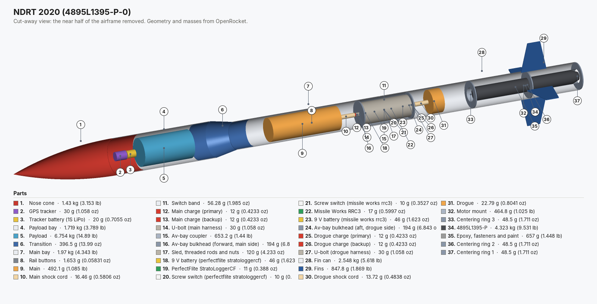
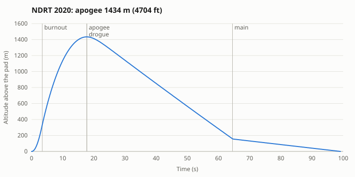
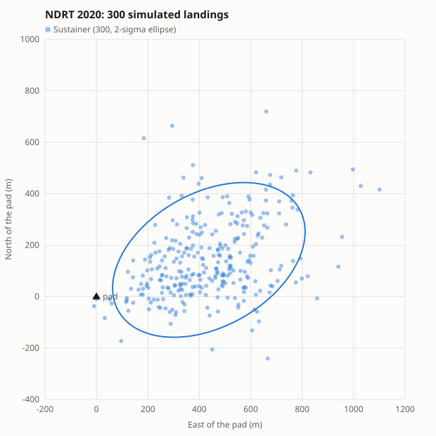
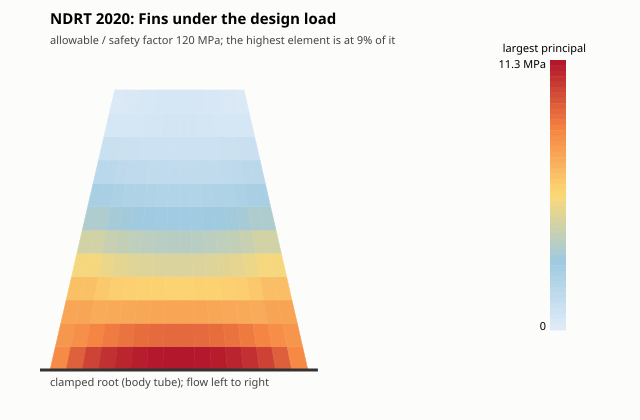
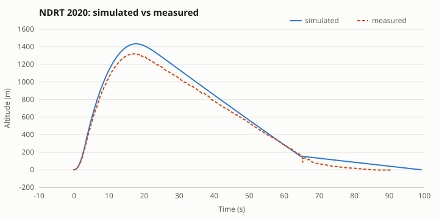
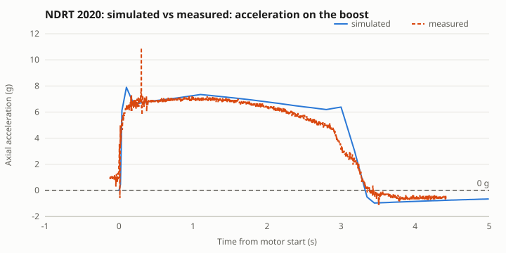

# Worked example: a real rocket, start to finish, checked against its flight

Most examples check a simulation against another simulation. This one checks it against a rocket that flew. The
Notre Dame Rocket Team's 2020 NASA Student Launch vehicle is rebuilt from its published dimensions and weigh-in,
taken through the analyses a team runs before launch day, and then compared, number by number, with the
altimeter and accelerometer log of its flight on 23 February 2020. **Every number below is real output from the
engine (OpenRocket 24.12 inside RocketMaxxing)**, produced by [`scripts/make_worked_example.py`]
(../scripts/make_worked_example.py). The flight data comes from the team via the open-source RocketPy project; see
[where the data comes from](#where-the-data-comes-from).

Use it as the pattern for your own rocket: build from drawings, correct to the weigh-in, set the day's weather, run
the checks, fly, then compare and calibrate before the next flight. Open
[`examples/ndrt-2020/ndrt-2020.ork`](examples/ndrt-2020/ndrt-2020.ork) in RocketMaxxing (or OpenRocket) to follow along.

**Steps:** [The headline](#the-headline) · [1. Build](#1-build-it-from-the-drawings) · [2. Weigh-in](#2-correct-it-to-the-weigh-in) ·
[3. Launch day](#3-set-the-days-weather) · [4. Predict](#4-predict-the-flight) · [5. Recovery](#5-recovery) ·
[6. Structures](#6-structures-and-the-rail) · [7. Electronics](#7-electronics) · [8. Fly and compare](#8-the-flight-against-the-simulation) ·
[9. What it teaches](#9-what-it-teaches) · [Data](#where-the-data-comes-from)

## The headline

| | Simulation (before flight) | Measured | |
|---|---|---|---|
| Apogee | 1,434 m (4,704 ft) | 1,320 m (4,330 ft) | measured 7.96% lower |
| Time to apogee | 17.72 s | 17.1 s | measured 3.47% lower |
| Burnout speed | 175 m/s (574 ft/s) | 159 m/s (523 ft/s) (integrated accelerometer) | measured 8.90% lower |
| Burnout | 3.45 s (end of the thrust curve) | 3.354 s (thrust falls below drag) | |
| Descent under drogue | 29.1 m/s (95.4 ft/s) | 25.1 m/s (82.2 ft/s) | measured 13.83% lower |
| Descent under main | 4.49 m/s (14.7 ft/s) | 3.94 m/s (12.9 ft/s) | measured 12.34% lower |
| Main opens | 550 ft set; 158.1 m in the simulation | ~170 m (the charge's pressure spike at 65.0 s) | |
| Landing distance | 532 m (1,747 ft) | 2,275 ft (reported) | |
| Descent time | 81.37 s | 68.5 s (log) | |

Stock OpenRocket put the apogee **9% too high** (1434 m against 1320 m). Fitting a drag factor to the
apogee alone says the rocket had 1.315× OpenRocket's drag. **The accelerometer
says otherwise:** the motor gave 0.9096× its published thrust (the climb was slow from
the first seconds), and the coast after burnout decelerated at 0.8073× OpenRocket's drag.
With both corrections the simulation follows the measured climb to within 4.85 m RMS, against
25.26 m for the drag-only fit and 73.1 m for OpenRocket as is. The details are in
[step 8](#8-the-flight-against-the-simulation).

## 1. Build it from the drawings

> **Ask:** "Build the NDRT 2020 rocket: 8 in tangent ogive nose 610 mm, 8 in payload bay to 1.2 m, a 127 mm transition to 6 in, 6 in body to 3.391 m, four fins (root 152, tip 76.2, span 165 mm, 13° sweep) at 3.05 m, CTI L1395, 24 in drogue at apogee and 120 in main at 550 ft"  
> Tools: `open_design`, `add_component`, `add_avionics_bay`, `set_motor`, `set_deployment`

The outside comes from the published model of the rocket; the inside (where bays split, wall thicknesses, fin
thickness, how the bay is laid out) is not published and is a reasonable guess. Each value is marked below.

| Part | Value | Source |
|---|---|---|
| Nose cone | tangent ogive, 610 mm, 203 mm base | published |
| Payload bay | 203 mm OD, 590 mm | published (outside) |
| Transition | 203 → 155 mm over 127 mm, starting 1.2 m from the tip | published |
| Main bay + fin can | 155 mm OD, 2,064 mm together; split at an avionics bay 889 mm down | outside published, split assumed |
| Fins | 4 × root 152, tip 76.2, span 165 mm, 13° leading-edge sweep, leading edge 3.05 m from the tip | published |
| Fin thickness | 4.76 mm (3/16 in) G10 with 10 mm fillets | assumed |
| Motor | Cesaroni Technology 4895L1395-P in a 75 mm mount, flush with the tail | published |
| Rail buttons | 1.5 m and 2.0 m from the tip | from RocketPy's model |
| Drogue | 24 in, Cd 1.5 (an elliptical canopy), at apogee | published (CdA) |
| Main | 120 in, Cd 2.2 (a high-drag annular canopy), at 550 ft | published (CdA, altitude) |
| Avionics bay | 12 in coupler, 1 in switch band, two altimeters on their own batteries and switches | assumed layout |

From the drawings alone the model weighs **11.58 kg** without the motor: the airframe, the bay
(1.409 kg) and the recovery gear. The real rocket weighed 18.998 kg, so
7.4 kg is missing: the payload, plus everything a model leaves out.

## 2. Correct it to the weigh-in

> **Ask:** "The rocket weighs 18.998 kg without the motor and we measured 2.875 cal on the pad. Make the model match"  
> Tools: `get_design`, `edit_components`

Two measurements (mass and stability margin, which fixes the CG) settle two unknowns. The model takes a payload in
the payload bay and a line for epoxy, fasteners and paint low in the fin can, and solves for both masses:

|  | Value |
|---|---|
| Payload (payload bay) | 6.75 kg |
| Epoxy, fasteners and paint (fin can) | 0.66 kg |
| Mass without motor | 19.00 kg (weighed) |
| Lift-off mass | 23.3 kg (51.4 lb) |
| CG on the pad / CP | 1865 mm / 2449 mm from the tip |
| Stability on the pad | 2.877 cal (measured 2.875 cal) |
| Stability at burnout | 3.588 cal |

Both masses come out physical: a 6.8 kg payload is what an 8 in payload section of a Student Launch rocket
carries, and 0.7 kg of glue, hardware and paint on a 3.4 m fibreglass rocket is normal. RocketPy's model of
this rocket gives a CG without motor of 1.30 m (± 0.1 m), which would mean 4.0 cal on the pad; this page
follows the team's measured margin instead. The CG barely changes the apogee (it is set by mass, thrust and drag).

## 3. Set the day's weather

> **Ask:** "Launch site Three Oaks, Michigan, 206 m, 11 ft rail. Fly it in the weather of 23 Feb 2020 at 16:00 UTC (the ERA5 reanalysis)"  
> Tools: `update_standards`, `weather_forecast`, `wind_profile`

A forecast is all a team has before launch; for a check after the flight, the reanalysis of the real weather is
better. Winds were light on the ground and much stronger aloft, which matters for drift:

| Height above the pad | Wind | From |
|---|---|---|
| 10 m | 4.4 m/s | 205° |
| 134 m | 7.4 m/s | 209° |
| 344 m | 10.9 m/s | 224° |
| 560 m | 12.4 m/s | 246° |
| 784 m | 12.3 m/s | 244° |
| 1,013 m | 14.2 m/s | 241° |
| 1,248 m | 16.1 m/s | 245° |
| 1,488 m | 16.9 m/s | 254° |
| 1,735 m | 16.5 m/s | 266° |
| 1,989 m | 15.5 m/s | 275° |
| 2,251 m | 15.2 m/s | 278° |
| 2,799 m | 15.2 m/s | 273° |
| 3,380 m | 15.7 m/s | 269° |
| 3,997 m | 17.5 m/s | 272° |

On the ground: 6.9 C (44.42 F), 99.12 kPa (14.38 psi), gusts to 10.2 m/s. The record goes in through
`weather_forecast` (pasted in its Open-Meteo form), which sets the site, temperature and pressure on the
simulation, and `wind_profile` lays the full set of levels over it, so every tool below flies the same day.
Ground (10 m): Open-Meteo's ERA5 archive. Aloft: ERA5 pressure levels from RocketPy's data file for this flight.
The rail was 11 ft (3.35 m) and vertical.

## 4. Predict the flight

> **Ask:** "Simulate the flight in those conditions, check our targets and give me the spread"  
> Tools: `run_simulation`, `targets`, `monte_carlo`, `aero_analysis`, `check_requirements`

| Prediction | Value |
|---|---|
| Apogee | 1,434 m (4,704 ft) |
| Time to apogee | 17.69 s |
| Top speed | 177 m/s (581 ft/s), Mach 0.53 |
| Peak acceleration | 6.891 G |
| Rail exit | 19.6 m/s (64.3 ft/s) |
| Thrust to weight | 6.283 |
| Stability at rail exit (in the wind) | 1.461 cal |
| Drogue / main descent | 28.2 m/s / 4.49 m/s |
| Landing | 532 m (1,747 ft) from the pad after 99.11 s |

OpenRocket's drag at zero angle of attack (power off; reference: the 203 mm diameter):

| Mach | CD | friction | pressure | base | CP from the tip |
|---|---|---|---|---|---|
| 0.1 | 0.2987 | 0.211 | 0.01699 | 0.07072 | 2440 mm |
| 0.3 | 0.3078 | 0.2094 | 0.02165 | 0.07678 | 2449 mm |
| 0.5 | 0.3272 | 0.206 | 0.0323 | 0.08891 | 2469 mm |

Friction is about two thirds of the drag: a long fibreglass rocket at low Mach. Keep this in mind for step 8.

**The team's targets** (NASA Student Launch limits of the time; check your year's handbook):

| Target | Simulated | Limit |  |
|---|---|---|---|
| Apogee | 1,434 m (4,704 ft) | 1067 m (3500 ft) to 1676 m (5500 ft), goal 1355 m (4444 ft) | PASS |
| Rail exit speed | 19.6 m/s (64.3 ft/s) | 15.85 m/s (52 ft/s) | PASS |
| Thrust to weight (rail) | 6.283 | 5 | PASS |
| Lowest stability | 1.892 cal | 2 cal | FAIL |
| Fin flutter margin | 1.362 | 1.5 | FAIL |
| Landing distance | 532 m (1,747 ft) | 762 m (2500 ft) | PASS |

Two lines need reading. *Lowest stability* is OpenRocket's in-flight margin just off the rail, at an angle of
attack of several degrees in the crosswind, where its CP moves forward; the static (zero angle of attack) margin
there is 2.939 cal, which is what Student Launch's 2.0 cal at rail exit means. The flutter line is the
team-standard margin of 1.5 on the NACA TN 4197 screen with the *assumed* fin thickness; see
[step 6](#6-structures-and-the-rail).

The 11 ft rail gives 19.59 m/s at rail exit, comfortably over Student Launch's 52 ft/s.
OpenRocket's 1.461 cal at rail exit is the same in-flight effect: at 19.59 m/s
with a 4.4 m/s crosswind the angle of attack is about 13°.

**Monte Carlo, 300 flights** (wind ± 1.5 m/s and ± 15°, drag ± 10%, thrust ± 4%, mass ± 2%, canopy Cd ± 10%):
apogee 1426 m ± 98.14 m (1 sd), range 1164 m to 1708 m. The measured
1320 m is **-1.1 sd** from the mean: inside the predicted spread, on the low side.
The spread is driven by thrust (r = 0.86) and drag (r = -0.26), not
by wind: the two things step 8 ends up measuring.

For comparison, the built-in **Launch Canada 2027** rule check (4 failure(s), 2 warning(s).) asks for more than Student
Launch did. What it would flag:

|  | Check | This rocket | Launch Canada asks |
|---|---|---|---|
| WARN | Simulated launch angle | 0 deg | 6 deg from vertical (84 deg elevation) |
| FAIL | Rail departure velocity | 19.59 m/s (64.28 ft/s) | >= 30.48 m/s (100 ft/s) (>= 25.91 m/s (85 ft/s) with detailed stability analysis) |
| FAIL | Thrust-to-weight at liftoff (avg thrust / liftoff weight) | 6.399 | >= 8 in 2027 |
| FAIL | Ascent stability (minimum, rail exit to apogee while airspeed > 100 ft/s) | 1.892 cal at t=0.5562 s, Mach 0.09116 | >= 2 cal (diameter change: use RASAero CP/CD overrides) |
| FAIL | Ascent stability in 8.333 m/s (27.34 ft/s) wind (minimum, rail exit to apogee while airspeed > 100 ft/s) | 1.408 cal at t=0.5562 s, Mach 0.0933 | >= 2 cal (diameter change: use RASAero CP/CD overrides) |
| WARN | Fin flutter margin (Fins, Fiberglass) | 1.362 at 304.3 m (998.5 ft), 178.6 m/s (586 ft/s) | flutter speed >= 1.5 x airspeed along the flight |

## 5. Recovery

> **Ask:** "Check the recovery: opening loads, shear pins, charges, landing energy and the altimeter settings"  
> Tools: `recovery_analysis`, `recovery_sections`, `ejection_charge`, `altimeter_settings`

| Device | Airspeed at opening | Infinite-mass load | Finite-mass load | Mass ratio | Design load | Harness rating |
|---|---|---|---|---|---|---|
| Drogue | 25.6 m/s | 213.8 N | 149.6 N | 0.0148 | 204.4 N | 408.8 N |
| Main | 27.81 m/s | 10548 N | 1471 N | 3.745 | 1471 N | 2943 N |

The main is a big canopy on a light rocket (Knacke mass ratio well above 1): the vehicle slows while the canopy
fills, so the infinite-mass load (Cx × q × CdA) is 7 times the finite-mass one. This page sets the team standard
`recovery.openingLoadMethod` to `finite_mass` for that reason; the drogue's load is floored at its steady drag.

| Section (lands on its own tether) | Mass | Descent rate | Landing energy |
|---|---|---|---|
| Nose cone .. Transition | 10.35 kg | 4.482 m/s | 104 J (76.69 ft-lbf) (EXCEEDS 101.7 J (75 ft-lbf)) |
| Main bay .. Switch band | 3.946 kg | 4.482 m/s | 39.64 J (29.24 ft-lbf) (within 101.7 J (75 ft-lbf)) |
| Fin can | 6.548 kg | 4.482 m/s | 65.78 J (48.52 ft-lbf) (within 101.7 J (75 ft-lbf)) |

The heaviest section (Nose cone .. Transition, with the payload) lands over the common 75 ft-lbf limit *in the
simulation*.
The real rocket came down slower under its main (3.935 m/s against 4.489 m/s):
the tumbling airframe and lines add drag that OpenRocket leaves out, so the simulated landing energy is on the
safe side. A team would size the main for margin anyway: `size_parachute` gives the diameter for any target rate.

| Bay | Pressurised volume | Design pressure | Primary charge | Backup |
|---|---|---|---|---|
| Main bay | 11.4 L (647.3 mm of tube) | 35.65 kPa | 1.861 g | 2.326 g |
| Drogue bay (fin can) | 6.4 L (360.3 mm of tube) | 35.65 kPa | 1.036 g | 1.295 g |

The pressurised volume is the stretch of tube between the closures around the parachute: in the main bay from
the transition's shoulder to the avionics coupler, in the fin can from the coupler down to the motor mount. The
charges break three 4-40 nylon pins with a 1.5 factor; three pins also hold the main bay shut while the drogue
opens (`recovery_analysis` sizes them from the drogue's load). Ground-test both before flight.

| Channel | Primary altimeter | Backup altimeter |
|---|---|---|
| Main | 167.6 m (550 ft) AGL on the way down | 137.2 m (450 ft) AGL on the way down |
| Drogue | apogee | apogee + 1 s |

Static ports: bay volume 307 in3: 4 ports of 0.219 in (5.6 mm) evenly around the switch band (same area as 3.1 x 1/4 in).

## 6. Structures and the rail

> **Ask:** "Will the fins flutter, what loads do the joints see, and are the rail buttons in the right place?"  
> Tools: `fin_flutter`, `structural_loads`, `fin_fea`, `rail_buttons`, `aero_heating`

**Flutter.** Fins: span 165 mm (6.496 in), root 152 mm (5.984 in), tip 76.2 mm (3 in) (equivalent), thickness 4.76 mm (0.1874 in); AR 1.446, taper 0.5013, t/c 0.03132. Flutter speed 240.4 m/s at sea level; the worst point is
178.6 m/s at 304.3 m, a margin of
**1.362** against the team's 1.5. 5.075 mm (0.1998 in) fins would meet it.
The fins survived the flight, as the screen's conservatism suggests; their real thickness is not published.

**Joint loads** (full vehicle: max q 19.07 kPa (2.766 psi) at t=3.275 s (Mach 0.5341), with a 8.333 m/s gust):

| Joint | Max compression (boost) | Bending (max q + gust) | Wall stress |
|---|---|---|---|
| Nose cone / Payload bay | 110.7 N | 19.16 N·m | 257.9 kPa |
| Payload bay / Transition | 770.2 N | 46.29 N·m | 664.8 kPa |
| Transition / Main bay | 800.8 N | 48.77 N·m | 1168 kPa |
| Main bay / Switch band | 1016 N | 44.03 N·m | 1116 kPa |
| Switch band / Fin can | 1082 N | 43.39 N·m | 1110 kPa |

A megapascal or so in fibreglass rated in the hundreds: the airframe is not the weak point at Mach 0.5. The
compression checks by hand: the mass ahead of the transition (about 10.6 kg) at the 7.9 g of first thrust is 0.8 kN.

**Fin FEA** (CalculiX shell model of one fin, clamped at the root; deck in [`fin-fea/`](examples/ndrt-2020/fin-fea)). Load: crosswind gust at max q at t=3.275 s, Mach 0.5341, q 19.07 kPa (2.766 psi), angle of attack 2.671 deg, 77.8 N on the most loaded fin.

| Fin under the worst gust | Result |
|---|---|
| Tip deflection | 1.705 mm (1.033% of span) |
| Peak stress | 11.26 MPa, against 240 MPa allowable (hand estimate 9944 kPa) |
| Margin of safety | 9.654 with the load doubled: PASS |
| First modes | 107.1 Hz (1st bending), 298.1 Hz (1st torsion) (hand estimate 88.1 Hz) |

CalculiX agrees with the hand estimates to within about 20%, and the first torsion mode sits well above the
first bending mode, the separation that keeps flutter away. Strength is not the fin's limit; stiffness is.

**Rail buttons.** With the aft button 1391 mm above the tail, the rocket leaves
the rail guide at 15.02 m/s, not the 19.59 m/s OpenRocket
reports (it counts the whole rail). Moving the aft button to the tail gives 19.49 m/s
(+4.467 m/s) on the same rail. Button positions here come from
RocketPy's model, not the team's drawings.

**Heating:** 20.99 C (69.78 F) at t=3.275 s at the nose tip: nothing to check below Mach 1.

## 7. Electronics

> **Ask:** "Will our sensors see the flight without clipping?"  
> Tools: `sensor_check`

| Sensor | Quantity | Peak | Use of range |  |
|---|---|---|---|---|
| Accelerometer, ±16 g | axial acceleration (x), boost and coast | 7.89 g | 49.31% of range | PASS |
| Accelerometer, ±16 g | lateral acceleration (y, z) | 0.179 g | 1.119% of range | PASS |
| Accelerometer, ±16 g | parachute openings | 35.79 g | 223.7% of range | WARN |
| High-g accelerometer, ±200 g | axial acceleration (x), boost and coast | 7.89 g | 3.945% of range | PASS |
| High-g accelerometer, ±200 g | lateral acceleration (y, z) | 0.179 g | 0.08948% of range | PASS |
| High-g accelerometer, ±200 g | parachute openings | 35.79 g | 17.9% of range | PASS |
| Gyroscope, ±2000 deg/s | roll rate (x) | 8.618e-06 deg/s | 4.309e-07% of range | PASS |
| Gyroscope, ±2000 deg/s | pitch / yaw rate (y, z) | 22.06 deg/s | 1.103% of range | PASS |
| Barometer, 30-125 kPa | pressure (lowest at apogee) | 83.02 kPa (12.04 psi) |  | PASS |
| GPS receiver | speed and altitude (export limits 515 m/s, 18 km) | 177.1 m/s (581.1 ft/s), 1640 m (5380 ft) MSL |  | PASS |

The real log's axial accelerometer read 10.8 g once (a single-sample spike at 0.42 s);
the next highest sample was 7.4 g, in line with the simulated 7.89 g. On the pad it read 0.87 g instead of 1 g: an offset the comparison removes.

## 8. The flight against the simulation

> **Ask:** "Here is the altimeter log from the flight. How close was the simulation, and what should we change for the next one?"  
> Tools: `compare_flight`

|  | Measured | Simulated |  |
|---|---|---|---|
| apogee | 1320 m (4330 ft) | 1434 m (4704 ft) | measured 7.96% lower |
| timeToApogee | 17.1 s | 17.72 s | measured 3.47% lower |
| descentRate 90%-60% of apogee (drogue) | 25.07 m/s (82.24 ft/s) | 29.09 m/s (95.43 ft/s) | measured 13.83% lower |
| descentRate under main (35% of its deployment altitude to 5 m) | 3.935 m/s (12.91 ft/s) | 4.489 m/s (14.73 ft/s) | measured 12.34% lower |

Time to apogee counts from lift-off to the top of a parabola fitted around apogee, for both curves: the top of
a flight is flat, and the highest raw sample of a barometric log can sit half a second off.

**Drag or motor?** An apogee alone cannot tell them apart: fitting only drag gives 1.315×. The log also has an axial accelerometer, and `compare_flight`
uses it: integrated, it gives the speed at burnout (thrust per unit mass); after burnout, the deceleration over
speed squared is the drag per unit mass.

The measured thrust follows the published curve for about 1.5 s, then falls steadily below it until burnout.
The motor file in the database is a 13-point curve; this motor delivered less in its second half.

|  | From the log | Simulation |
|---|---|---|
| Burnout speed | 159.3 m/s (522.8 ft/s) | 174.9 m/s (573.9 ft/s) |
| Coast drag | 0.8073 x OpenRocket's (drag / mass / v^2, 0.3 to 1.07 s after burnout) |  |
| Thrust that gives the measured burnout speed | 0.9096 x the motor's thrust gives the measured burnout velocity |  |
| Drag that then gives the measured apogee | 0.7578 x OpenRocket's drag then gives the measured apogee (the coast measured 0.8073) |  |
| Apogee difference split | -114.1 m (-374.5 ft) in all: -196.7 m (-645.5 ft) from the boost (thrust x0.9096) and 82.59 m (271 ft) from drag |  |

Two independent measures of drag agree (the coast deceleration and the apogee once thrust is corrected), and
the result follows the whole climb:

| Version of the simulation | RMS altitude error, lift-off to apogee |
|---|---|
| OpenRocket as is | 73.1 m (239.8 ft) |
| drag x1.315 (apogee alone) | 25.26 m (82.89 ft) |
| thrust x0.9096, drag x0.7578 | 4.85 m (15.91 ft) |

With thrust ×0.9096 and drag ×0.7578 the simulation
reaches 1319 m at 17.39 s with 159.8 m/s at burnout.

*Mostly the boost: the motor delivered less (or more) than its thrust curve; calibrate drag only after allowing for it.* Assumes a near-vertical boost and an accelerometer whose gain is right (its offset is removed from the pad reading); motors of one type vary by a few percent in impulse.

**Descent.** Under the drogue the real rocket fell at 25.07 m/s, against 29.09 m/s
simulated, and under the main slower too. OpenRocket counts only the canopy; the airframe sections tumbling on
their tethers add drag, so its descent rates (and landing energies) are on the safe side.

The real main fired at about 170 m (65.0 s) and took a while to bite: the log shows 116 m at 67 s,
68 m at 70 s and 58 m at 72 s, about 100 m and 5 s of canopy opening before the slow
descent. OpenRocket opens a canopy at once (at 158.1 m: its descent time step lets it
fire a few metres below the 550 ft setting) and then floats down for the rest. So the simulated descent is
longer (81.37 s against 68.5 s) even though its rates are faster: worth knowing when a rule caps
the descent time.

The simulated drift, 532 m (1,747 ft), is short of the reported 2,275 ft
(with the ground wind alone it was 87.9 m (288 ft)). The reanalysis is an hourly mean on a 0.25° grid,
and the descent is the longest stretch of the flight in the strongest wind.

**The team's own numbers**, checked with `verify_claims`:

| Claim | Source |  | Model | Difference |
|---|---|---|---|---|
| static margin: 2.875 cal | team's measured margin | MATCH | 2.877 cal | +0.001922 cal (+0.06685%) |
| apogee: 4,444 ft | declared target | MISMATCH | 1434 m (4704 ft) | +79.29 m (260.1 ft) (+5.854%) |
| landing distance: 2,275 ft | measured drift | MISMATCH | 532.5 m (1747 ft) | -160.9 m (527.8 ft) (-23.2%) |
| motor: CTI L1395 | flight log | MATCH | 4895L1395-P |  |

The declared target sits between the flown apogee and stock OpenRocket's prediction; the drift is the one
number the model gets short, for the reasons above.

## 9. What it teaches

1. **Weigh the rocket and measure its CG, then make the model match.** From drawings alone this model was
   7.4 kg light.
2. **Use the day's real winds aloft.** With only the ground wind the simulated drift was 87.9 m (288 ft);
   with the profile, 532 m (1,747 ft), and the real drift was further still.
3. **Fly an accelerometer, not just a barometer.** The apogee alone would have calibrated drag to 1.3×; the
   accelerometer shows the motor was the main cause, and OpenRocket's drag was if anything 20% high. A team
   carrying 1.3× drag into its next design would have under-predicted a motor that performs to its curve.
4. **Treat a motor's published curve as a nominal.** Run Monte Carlo with a few percent of thrust spread, and
   compare the boost on every flight.
5. **Simulated descent rates are on the safe side** for landing energy, but the simulated descent *time* is not
   (canopies open at once in the model). For the opening load of a big canopy on a light rocket, use the
   finite-mass method.
6. **Check what a tool assumes.** Building this example found and fixed several things in the engine: motor names
   with the maker in front ("CTI L1395") in `set_motor` and `verify_claims`; in `compare_flight`, the main's
   descent band (it read the canopy opening), the apogee time (the raw highest sample) and the accelerometer, which
   it now uses; the wind's drift in the landing speed of `recovery_sections`; and the pressurised volume of a bay,
   which counted the whole tube instead of the stretch between bulkhead, coupler and motor mount.

## Where the data comes from

- **Rocket and flight:** the Notre Dame Rocket Team's 2020 vehicle, launched 23 Feb 2020 near Three Oaks,
  Michigan. Dimensions, masses, motor, recovery and the flight log (`flight-log.csv`: barometric altitude at 20 Hz
  and axial acceleration at 400 Hz) are from the [RocketPy](https://github.com/RocketPy-Team/RocketPy) project's
  `ndrt_2020_flight_sim` example and `data/rockets/NDRT_2020/` (MIT License; the notebook records the team's
  permission to use the flight data). The team's reported results: stability 2.875 cal, target 4,444 ft,
  apogee 4,320 ft, drift 2,275 ft.
- **Weather:** ERA5 reanalysis (Copernicus Climate Change Service): pressure levels from RocketPy's
  `ndrt_2020_weather_data_ERA5.nc`, the 10 m wind and 2 m temperature from the Open-Meteo archive API.
  Contains modified Copernicus Climate Change Service information 2020. Weather data by Open-Meteo.com (CC BY 4.0).
- **Motor:** OpenRocket's built-in Cesaroni 4895L1395-P thrust curve.
- **Assumed** (not published): the inner layout, wall and fin thicknesses, the avionics, the split of the
  unmodelled mass between payload and hardware. Mass and stability are matched to the measured values.

Files: [`ndrt-2020.ork`](examples/ndrt-2020/ndrt-2020.ork) · [`flight-log.csv`](examples/ndrt-2020/flight-log.csv) ·
[`flight-card.md`](examples/ndrt-2020/flight-card.md) · [`landing.kml`](examples/ndrt-2020/landing.kml) ·
[`fin-fea/`](examples/ndrt-2020/fin-fea) · [data notice](examples/ndrt-2020/README.md)
